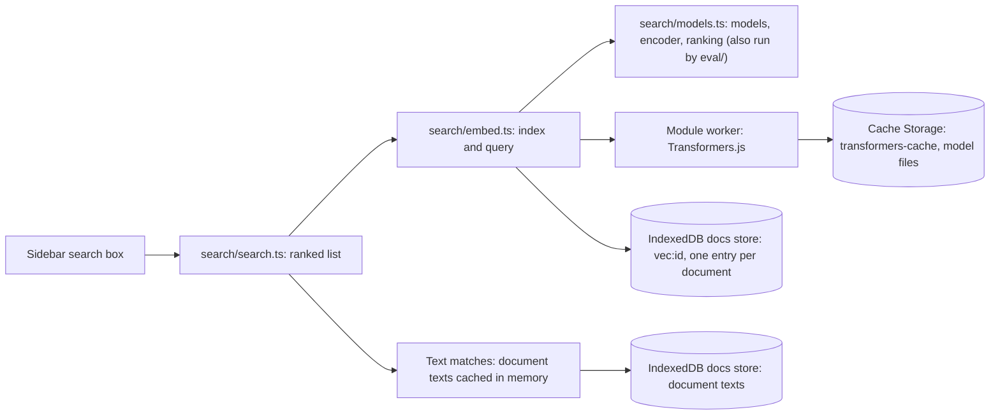
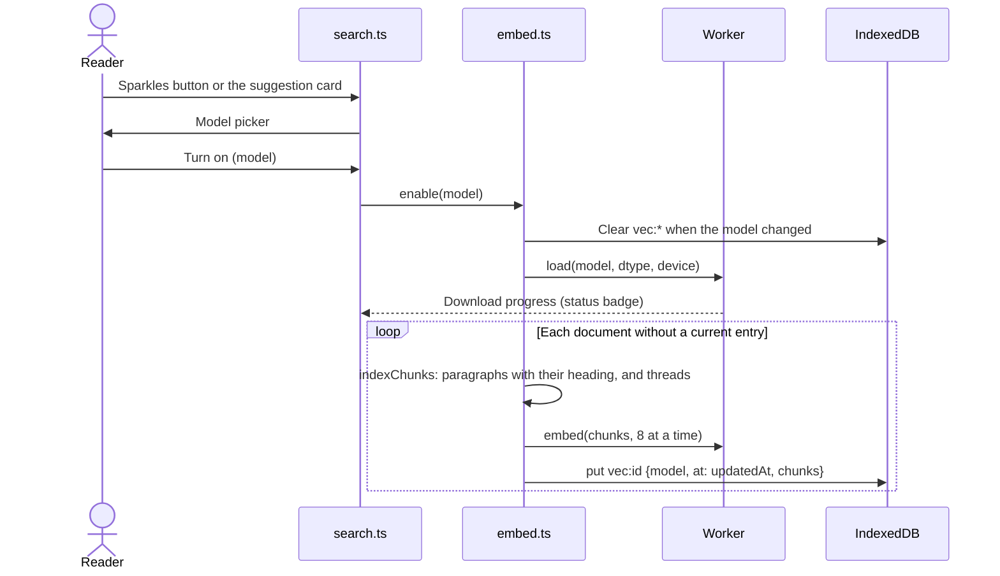
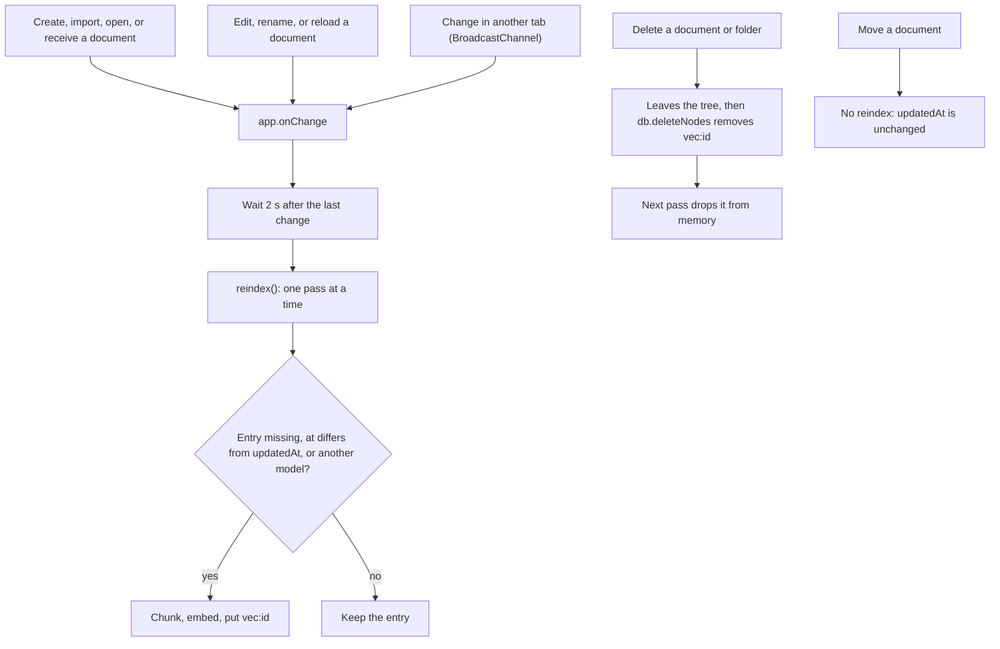
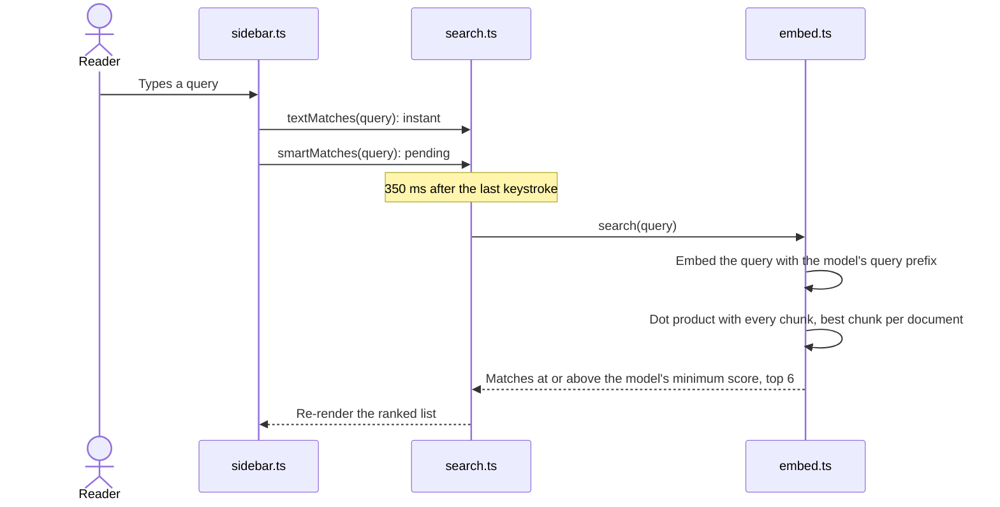

# mars

The MARS (Markdown Annotation & Review System) app, bundled into `dev/tools/mars.html`
through the `data-su-bundle="mars"` placeholder. `npm run build` writes `dist/mars.js`
(esbuild, ESM, minified). See [`dev/tools/guides/mars.md`](../../guides/mars.md).

Pinned runtime dependencies: `marked` 18.1.2 (the version md.html's unpinned CDN load
resolved to when MARS was extracted) and `fflate` 0.8.3 (same as `three-mf`).
Sync also uses Yjs, Noble Curves, and DOMPurify. Their exact pins live in `package.json`.
The connection manager initializes only for enrollment, Sync links, or connected content.

## Connected documents

**Sync** enrolls one document or a selected folder subtree in encrypted responder storage.
The Sync dialog shows a **Sync link** after setup. It connects another device after both devices show the same code.
Back appears at the bottom-left of each subpage. The close icon closes the whole dialog.
**Sync** manages your personal devices. **Disconnect this device** retains a local document and leaves other devices and active Live links connected.
**Live links** separately manages source-side sharing. **Live document** shows a recipient's access, expiry, and local-copy actions.
**Keep as local copy** stops that recipient's updates without disabling the owner's link. **Stop sharing** disables every Live link for the source document.
Disabling the last link on a Live-only document also purges its remote data and releases reserved capacity.
Explicit personal Sync remains independent of Live sharing. Ended recipients show a disconnected local-copy badge.
The original window stays open only for code approval. Later sync does not require both devices to remain open.
Sync links connect your own devices with the same review identity. Live links give other people their own view, comment, or edit access.
Normal ZIP and Markdown exports keep content. The optional encrypted backup also preserves Sync access and its pending upload state.
New Sync links use a 22-character `#sync=` fragment and an encrypted setup bootstrap with a ten-minute expiry.
Existing long `#sync=` and `#invite=` links remain supported. Setup encryption and request authentication use separate derived keys.
Existing origin IDs, names, and content provide matching hints in a populated library.
The reader can keep copies separate or connect the existing local ID. Different local content stays in an independent backup.
New documents inside a synced folder join that collection. Moving existing local content into it requires confirmation.
Local-only documents outside the selection stay local.
Each IP address can create 50 Sync collections per hour. This limit is `LIMITS.collections` in `src/sync/protocol.ts`.
The responder uses that same value for enforcement and `/sync/limits`. Other storage and item limits remain unchanged.
Saved folder contents can upload even when no document is open.
Sync enrollment, upload acknowledgements, key updates, and connection metadata do not change document timestamps or invalidate the smart-search index.
Document text and name changes still update the timestamp and refresh that document's search entry.

The header shows service acknowledgement, pending local work, offline work, or a connection error.
**Up to date** does not mean that another person read the document.
Local edits enter a durable outbox before upload. Retries reuse the stored ciphertext.
An active document or folder renews its 30-day inactivity lease. Polling alone does not renew it.
Opening a synced folder renews every enrolled document and nested folder entry. Individual files do not need separate opens.

Share offers **Snapshot** and **Live**. Live links grant view, comment, or edit access to one document.
The Share menu and document/folder menus have one **Copy link** entry. Its dialog defaults to Snapshot and Full, with Full first.
Short snapshots and all Live links offer 1/7/14/30-day expiry without calendar dates.
The dialog explains the Copy link action before generation and shows the read-only URL after generation, including clipboard failures.
Source-side **Live links** is a bottom-left action in the Copy link dialog, not an item or Share menu entry.
Recipients use Copy link → Live to forward an active owner's link, with read-only access and expiry information.
Forwarding retains the original URL and does not create a grant. Expired or disabled links offer snapshots only.
Full snapshots do not expire. Folder links currently support snapshots only. Specialized Slack, GitHub, and agent copy actions remain available.
Live recipients have a persistent access badge. View/comment modes hide body-editing handles and disable task changes.
Live recipients use temporary memory storage by default. **Save live document to library** retains the document, its connection, and unsent changes.
Promotion copies the selected vector record and loads the persistent library index. Unchanged library documents retain their vectors and timestamps.
New Live links use a 22-character fragment secret and encrypted KV bootstrap, with 1/7/14/30-day expiry and a 7-day default.
Existing long Live links remain supported. See [the cryptographic contract](src/sync/README.md#short-live-links).
Edit access permits actor-signed comment and thread deletion, but not edits that impersonate comment authors.
Synced replies retain conversation order. Edits and deletion Undo do not move earlier comments.
Opening a connected document does not publish review edits. Retained empty threads remain available for replies and recovery without becoming deletion intents.
Reload restores acknowledged live content, not unsent temporary edits.
Transport keys, credentials, and outboxes never enter ordinary Markdown, HTML, PDF, ZIP, or agent handoffs.

Connected libraries use safe previews. Received HTML cannot provide scripts, application controls, arbitrary CSS, or source-range attributes.
Linked files require explicit disk Save. Incoming remote edits never write to disk automatically.
Overlapping cell/block drafts offer **Save draft as copy** before applying a remote update.

**Disconnect this device** disconnects this local replica and retains its text. It does not remove access for every other device.
**Devices & links** lists devices and Live links. Each connection has its own disconnect or disable action.
Disconnection rotates the affected document keys. Saved copies and pending work on the disconnected device stay there.
Encrypted recovery packages contain scoped credentials and pending work. They use a separate password, not an account login.
Download and Export all offer optional connection recovery. The default remains a normal Markdown or ZIP download.
The optional ZIP contains readable documents and one encrypted recovery file under `MARS connections/`.
Import offers documents-only import or password-protected connection restoration. Existing libraries remain unchanged.
The encrypted payload groups selected connections and local documents. Partial selections exclude unrelated replica bodies and document keys.
Recovery restores all selected replicas in one transaction. It also restores the secrets for owned live links.
Large backups use authenticated binary chunks instead of the 16 MiB JSON format. The archive limit is 512 MiB of serialized replica data.
An interrupted removal retains its exact key updates. **Try again** resumes that plan after reload.
Close the previous browser window before restoring its credentials in another profile.
Review-deletion Undo cancels the deleting actor's signed operation. It restores original author attribution rather than publishing a new comment version.

Release checks passed on 2026-11-08. Sync and live links require no account, extension, or local helper.

## Buttons and feedback

MARS uses the native EUI-style primitives and [button guidance](../../guides/design-system.md#buttons-loading-and-copy-feedback).
Generated dialogs use `buttonClass` for primary, secondary, empty, and flush variants.
Loading actions use the shared EUI bordered spinner. Clipboard actions show a brief Copied tooltip without changing the dialog layout.
`src/ui/feedback.ts` provides plain-text, viewport-clamped tooltips for pointer and keyboard users.
Icon labels remain accessible when responsive layouts hide their text.

## Isolated browser-test data

MARS mutation specs use `e2e/tools/_mars_test.ts` instead of importing `test` directly from Playwright.
The fixture registers an authenticated test scope and applies it to the default context and additional `browser.newContext()` contexts.
Test snapshots, Sync collections, invitations, and quota ledgers stay under `testing/v1/data/<scope>/`.
Ordinary user records remain outside this namespace.

Only the Node test process receives the operator credential. Synthetic browsers receive a separate capability for their test scope.
That capability expires after one hour. It does not authorize operator actions or access to other scopes.
Teardown closes test contexts and deletes the complete scoped data, including its quota ledgers.
Tests fail if scope creation or cleanup fails. They never fall back to ordinary production storage.

The operator-only `/sync/testing` endpoint records run ID, test ID, title, creation time, expiry, cleanup state, and the removed-entry count.
Completed audit records expire after 14 days. Interrupted scopes retain their metadata until cleanup resumes.
Private recovery manifests live under `e2e/.cache/mars-test-scopes/<run>/` with mode `0600`.
Manifests contain the scoped capability and delete tokens for any ordinary preservation canary, never the operator credential.
The cleanup attachment omits all credentials.

For production checks, use `MARS_TEST_OPERATOR_KEY` or the operator API key in the root `.env`.
The local preview uses `local-operator-secret` unless `MARS_TEST_OPERATOR_KEY` specifies another key.
The test client sends operator credentials only to the configured MARS origin or a loopback preview. Redirects are forbidden.

Run these recovery commands from the repository root:

```bash
# List metadata without exposing capabilities or user content.
node --env-file=.env scripts/mars-test-cleanup.ts --list https://mars.secutils.dev
# Remove expired or interrupted test scopes only. Active tests and user data remain intact.
node --env-file=.env scripts/mars-test-cleanup.ts --expired https://mars.secutils.dev
# Resume one recorded scope after a lost cleanup response.
node --env-file=.env scripts/mars-test-cleanup.ts <private-manifest.json> https://mars.secutils.dev
```

Native or manual mutation checks use the local preview unless they attach an operator-registered test scope.
Never clear `sync/v1/` or snapshot prefixes as routine test cleanup.

## Development

```bash
npm ci
npm test            # codec, tree, merge, diff, match, and search logic (node --test)
npm run typecheck
npm run serve       # http://localhost:7373/ (+ /llms.txt), short links on an in-memory KV
npm --prefix eval ci && npm --prefix eval run eval -- --check   # search quality, see Evaluation
```

`src/doc/viewer.js` is a copy of md.html's live script; `src/doc/doc.css` copies its
preview styles. Borealis tokens, visual primitives, and EUI glyphs live in `dev/tools/shared/`.
MARS imports them through its bundle, and ECHO consumes the same source.
`src/ui/icons.ts` preserves the typed MARS API over the shared glyph catalog.
Read [the design-system guide](../../guides/design-system.md) for migrations and new glyphs.

The logo lives in `dev/tools/mars/assets/` (app icon, favicon, wordmark, and the PNG
favicons rendered from them). `mars.html` inlines copies: the header mark (the wordmark's
planet) and the favicon data URIs. The `--mars-*` / `--brand*` tokens in
`src/ui/tokens.css` follow the logo's reds.

## Temporary sessions

**New temporary document** opens a session with no IndexedDB reads or writes.
**Document options > Read temporarily** opens the current document in that mode.
The existing library remains unchanged. **Save current to library** is the explicit return to persistent storage.

Document action menus use **Download** for Markdown output. Advanced HTML/PDF output stays in the document view's **Export…** workspace.
Dragging moves a document to the top level. The document menu has no separate move action.

If browser storage is denied or a write reaches its quota, MARS falls back to a temporary session.
The header displays **Temporary**, not **Saved**. The banner explains the storage failure and recovery options.
Editing, comments, table layouts, sharing, HTML/PDF output, and Markdown downloads remain available.
Opening a file temporarily does not link it for autosave. Only an explicit save can write a file.

The address bar retains the current document through the standard compressed fragment, with `t=1`.
It includes the name, origin, reading width, frontmatter, and review metadata.
Only the current document returns after reload. Other session documents and folders require ZIP export before closing.
Automatic URL recovery stops at 16 million source characters or a two-million-character fragment.
An unavailable or oversized URL produces a download warning, rather than a stale recovery link.
Saving to the library uses this portable URL. Larger documents require a Markdown download and a normal library import.

Temporary mode is not private browsing. Browser history can retain the fragment, and browser preferences can still persist.
Short-link creation remains explicit and uploads only encrypted content. Its deletion token stays in the temporary tab, not local storage.
Images, fonts, map tiles, and explicit URL loads retain their normal network behavior.

## Document browser actions

Right-click a document for the MARS action menu, as before.
**Shift + right-click** its name or icon for the native browser link menu.
Ctrl/Cmd + click, middle-click, and Shift + click keep their native browser behavior.
These links open the stored document in the same browser profile, not a shared copy.
They also work in search results. The `⋮` button always opens MARS actions.
Private windows and other profiles cannot read the original browser storage.
Split-view commands depend on the browser. MARS does not add entries to native menus.

The document link uses `#doc=<id>`, without compression or server storage.
Pointer navigation flushes pending edits before another tab reads the document.
The sidebar keeps the anchor until the gesture finishes, so that save does not cancel navigation.
Keyboard navigation, renaming, and tree dragging retain their existing behavior.

## Preview edits

Document links in Preview open in a new tab with `noopener noreferrer`.
This includes Markdown links, autolinks, and embedded HTML links.
Fragment links still scroll within the document. Source text and exported links stay unchanged.

Selection formatting supports wrapped list items with bold text and inline code.
The edit preserves source indentation, list markers, and text outside the selection.
**Mark done** is available only for headings and existing task checkboxes.
Regular list items support manual strikethrough through the selection toolbar.
These edits support undo and redo.
On touch devices, the formatting toolbar follows the visible selection inside the visual viewport.
Native long-press cancellation does not leave it waiting for a mouse release.

All five selection styles work in GitHub alert bodies, including nested blockquotes.
Formatting preserves alert directives and quote prefixes. Generated alert titles offer **Comment** only.

The reading width in **Options** persists in browser storage.
Reloads and new tabs restore the selected width, including full and custom widths.

Block controls occupy a reserved left gutter at every reading width.
Hover over a block or its left-side whitespace to show **Add** and **Block actions**.
Between items, controls stay with the hovered neighbor until the pointer enters another item.
Dragging works past multiline and nested list items. Holding the pointer near an edge scrolls the preview.
Ordered-list moves renumber the Markdown from the list's original starting number and preserve the marker style.
Continuation indentation adjusts when a number gains or loses a digit. Nested text and code remain unchanged.
Undo restores the original order and numbers.

## Mermaid navigation

Mermaid diagrams have zoom buttons, a percentage button for actual size, and **Fit**.
The controls remain visible in fullscreen.
Readers can drag with a mouse, scroll with a trackpad, or swipe on a touchscreen to pan.
Ctrl/⌘ + scroll and trackpad pinch zoom at the pointer.
Double-click zooms in. Shift + double-click zooms out.
The focused diagram supports arrow keys for pan, `+` and `-` for zoom, and `0` for fit.
Touchscreen pinch keeps the browser's page zoom.
Zoom and pan do not change the Markdown or shared links.
Unchanged diagrams retain zoom, pan, and Fit mode after unrelated block or Source edits.
Identical diagrams keep separate views. A changed diagram starts in Fit mode.
Opening a document or reloading the page starts fresh views. Exports and links do not store these views.
Markdown Preview uses the same navigation. Its HTML and PDF exports keep the complete static SVG.

## Source editor

CodeMirror draws selection backgrounds below the text lines. The active-line tint stays
translucent so it does not hide selected text. The gutter keeps its opaque background.
The shared browser tests check painted selection pixels in Firefox and Chromium, in both themes.

## Table editing

Connected previews preserve validated table proportions through the safety sanitizer.
The renderer carries numeric layout separately from untrusted raw HTML and applies widths after sanitization.
Preview and HTML/PDF output use the same helper. The Markdown `su-table` format is unchanged.

In Preview, selecting a table cell displays row and column handles beside the visible selection.
Their thin grips use the selected cell's left and top borders as their baseline.
The visible grips stay compact while their touch targets remain larger.
Click or tap a handle for its compact action panel. Hover shows the reorder grip where movement is available.
Panels stay inside the reading pane, even when the table header has scrolled away.
Double-click a cell to edit its Markdown without opening the whole table source.
Like block editing, Escape or Ctrl/Cmd+Enter applies the edit without separate Apply/Cancel buttons.
Enter inserts a line break, stored as `<br>`. Literal pipes are escaped automatically.
Clicking outside, switching views, sharing, and exporting apply the current cell edit.
With a cell focused, Enter opens its editor. Arrow keys inside the editor move the caret.
Column actions include EUI alignment icons for **Left**, **Center**, and **Right**, with accessible names and tooltips.
Alignment applies to the whole column, including its header.
Alignment changes only the GFM divider colons. Each cell edit or alignment change is one undo step.
Header boundary handles resize adjacent columns with mouse or touch.
Insert/remove buttons edit rows and columns, and grips reorder rows vertically or columns horizontally.
Move buttons and arrow keys provide keyboard alternatives.
Resize handles also support Left/Right arrow keys, with larger steps while Shift is held.
Each completed drag is one undo step. Escape, pointer cancellation, navigation, and export capture cancel unfinished drags.
An unchanged preview redraw retains an active row/column drag. Escape first closes an open action panel, then clears the table selection.
The header row stays fixed, and the table retains at least one column.

`src/doc/table.ts` owns source parsing, metadata, cell edits, alignment, and structural edits.
`table-renderer.ts` adds exact source ranges through isolated MARS hooks in the shared block mapper.
`table-layout.ts` reads adjacent comments and applies column proportions through a `colgroup`.
`table-editor.ts` owns selection, pointer capture, cancellation, keyboard controls, and drag auto-scrolling.
The renderer and export pipeline both apply the layout before their own UI/runtime initialization.
Exported HTML and PDF retain proportions and omit editing controls.

```markdown
<!-- su-table {"v":1,"cols":[0.25,0.75]} -->
| Name | Status |
| --- | --- |
| Alice | Ready |
```

The one-line comment stores positive weights normalized to the table width.
Its column count must match the table header.
Files and full/short links carry this Markdown, so column proportions need no new storage schema or compression format.
Full and short links also carry the document reading width, so a private browser retains the same layout at the same viewport size.
Each received document stores this width separately from the browser preference.
Opening another document restores the browser preference. Explicit width changes update the shared document and the preference.
Full document links use optional `w=800`, `w=1100`, `w=full`, or a custom integer from 320 to 2400.
Encrypted bundles store optional `readingWidth` on each document. Invalid values and legacy links retain the recipient's preference.
An explicit `w` fragment parameter also supplies a width for older short links.
Embedded-source HTML also retains the comment for reopening.
Invalid metadata keeps automatic sizing without changing the source.
Structural edits preserve cell Markdown, alignment, surrounding content, and review threads.
Review comparisons group the metadata with its table, and **Show before** retains the old column proportions.
Raw HTML tables, excess source cells, and unlocatable source ranges remain read-only.
Row heights remain automatic. Markdown Preview is unchanged by user decision.

Unit cases are in `test/table.test.ts`, and browser coverage is in `e2e/tools/mars-tables.spec.ts`.

## Source imports

Open, file drops, library imports, Load URL, and `?url=` use `src/io/source.ts`.
The helper extracts Markdown from an exported HTML file that contains an embedded source block.
HTML without that block remains raw HTML.
The helper does not reconstruct Markdown from rendered HTML.
Converted HTML has no writable link to its original file.

Explicit incoming names take priority over frontmatter titles, Markdown headings, and filename fallbacks.
Filename fallbacks and explicit names lose Markdown and HTML extensions.
ZIP imports use their entry filenames as explicit names, so backups retain document names after restore.
Ordinary Markdown imports and unchanged downloads retain CRLF and the original review-block formatting.
Review edits still serialize changed metadata normally.

Both URL entry points call `share.receiveUrl()` and retain a stable URL origin.
Reopening a known URL uses the existing incoming-copy decisions, including **Keep my text** and **Save as a copy**.
An unsuccessful URL fetch retains the previous document.
The browser fetches the source directly, without an API proxy.

`src/io/input.ts` owns cancellation and generation checks across asynchronous source input.
A new file, document, or URL supersedes an earlier load.
Superseded operations cannot select another document or apply late results.
Conflict dialogs close when their input operation is canceled.
The browser import cases are in `e2e/tools/mars-import.spec.ts`.

PDF Extractor's **Export > Open in MARS** uses the same full-link receive path.
Its Text and Markdown tabs send the exact extracted text and an explicit PDF document name.
The handoff uploads neither the PDF bytes nor the extracted text.

## Export workspace

**Export…** opens a native dialog with HTML and PDF tabs.
The heading identifies the document without a separate subtitle.
The dialog uses most of the viewport, with the format tabs centered above the settings column.
The HTML preview shows the same standalone document that **Copy HTML** and **Download HTML** use.
HTML settings include reading width, table of contents, find, a PDF action, and optional embedded source.
All HTML settings appear together, without a disclosure section.
Export width does not change the reading width in MARS.
Embedded source contains the document body, without frontmatter or review threads.
**Download Markdown** retains the complete document, including frontmatter, line endings, and review threads.

The PDF tab prepares pages for A4 or Letter, in Portrait or Landscape orientation.
The preview centers the pages and scales them to fit without changing their print dimensions.
**Print / Save PDF** sends these prepared pages to the browser print dialog.
After the browser print dialog closes, focus returns to this action if the same PDF workspace remains open.
Only the dialog footer contains this action. The preview frame contains no print button.
The status appears during preparation or after a failure, but disappears when the preview is ready.
MARS does not download PDF bytes or know whether the reader saved a file.
`Ctrl/Cmd+P` opens this tab and exits document fullscreen first.
Document action menus can export another document without changing the current selection.
Folder ZIP exports and exports to disk remain unchanged.

The dialog keeps an immutable snapshot and separate draft settings.
An output action commits settings to `mars.exportSettings` (version 1).
Closing the dialog discards later draft changes.
A document reload shows **Refresh preview**, rather than replacing the snapshot silently.

`src/export/` owns settings, snapshots, standalone output, and the dialog.
The viewer commits a block edit and flushes storage through `captureExportSnapshot()`.
`renderExportBody()` uses export-safe rendering without changing the current name or review threads.
HTML and PDF share one render per snapshot, including saved model views and complete Mermaid SVGs.
`src/doc/diagrams.js` supplies the shared map and model runtime.
The build compiles reader and print runtimes separately, then embeds their source strings.

Preview frames have opaque origins and no access to MARS storage or its DOM.
Their message bridge checks both the source window and the operation identifier.
Closing or replacing a preview disposes its frame and listeners.
Cancellation stops export model workers and ignores superseded preparation results.

Paged.js 0.4.3 loads from jsDelivr only when PDF pagination is needed.
App startup, HTML preview, and Markdown download do not fetch it.
Subsequent preparations use the browser HTTP cache.
Exported maps and models need no external renderer, but basemap tiles, images, fonts, and math styles can need network access.
PDF uses light styling, vector text, complete Mermaid diagrams, and static color images for WebGL models.
The dialog follows the MARS theme, but PDF pages remain white in every theme.

The export browser cases live in `e2e/tools/mars-export.spec.ts` and run against the deploy-equivalent local server.
`e2e/tools/mars-models.spec.ts` covers binary/ASCII STL, large meshes, colored 3MF, ZIP64, invalid geometry, and cancellation.
System print dialogs and saved PDF files still require manual browser checks.

### HTML export boundary

The export renderer removes document-supplied `script`, `style`, `iframe`, `object`, `embed`, `base`, `meta`, and `link` elements.
It also removes event-handler attributes, `javascript:` URLs, and internal source-range attributes.
The exported body excludes YAML frontmatter and trailing review metadata. Markdown downloads retain both.

Ordinary HTML content and inline styles remain. Images, audio/video, links, and inline CSS can still load remote resources.
MARS adds its own reader and widget runtimes after this cleanup, so supported maps and models remain interactive.
This boundary is not a complete HTML sanitizer and does not make arbitrary HTML safe.

Controlled third-party embeds are not necessary for the current Markdown workflows.
An embed feature requires a separate provider, sandbox, privacy, offline-output, and PDF-fallback design.

## Search

The sidebar search box matches document names, folder names, document text, and review
comments. With smart search on, it also matches passages and comments by meaning. All
matches appear in one ranked list: name or folder matches first, then text matches with a
snippet, then matches by meaning, marked with sparkles and ordered by similarity. A document
appears once, at its best rank. Opening a text match opens Find on the query; opening a
match in a comment, or by meaning, scrolls to the passage.

Each review thread is indexed as one chunk: its quote and comments, labelled
`Comment on “…”:` (`chunks.threadChunks`). Passages and threads under three words get no
vector (`chunks.embeddable`): a one-word note like "Dog" scores above the cut-off against
almost any short query.

Smart search is off until the reader turns it on and picks a model. Nothing about it ships
in the bundle: Transformers.js loads from jsDelivr, and the model from Hugging Face.



| Model | Hugging Face id | Download | Languages | Vector | License |
|-------|-----------------|----------|-----------|--------|---------|
| Best speed (default) | `Xenova/gte-small` (fp16 on WebGPU, q8 on CPU) | 68 MB / 35 MB | English | 384 | MIT |
| Best quality | `onnx-community/embeddinggemma-2-ONNX` (q4f16, or q4 without `shader-f16`; WebGPU only) | 190 MB / 207 MB | 100+ languages | 768 cut to 256 | Apache-2.0 |

`models.placement` picks the device and weights per browser: float16 weights on a WebGPU
adapter with `shader-f16`, the CPU weights otherwise. The picker shows that download size.

`search/models.ts` holds the model table and the pure parts of embedding: input prefixes,
the encoder, normalization, and ranking. The app's worker and the evaluation both run it, so
the evaluation measures what ships. The encoder follows the model cards: Transformers.js
`AutoModel`, the model's `sentence_embedding` output when it has one (EmbeddingGemma),
otherwise mean pooling (GTE). EmbeddingGemma 2 loads text-only (`vision_config` and
`audio_config` set to null); otherwise its vision and audio encoders download too, 300 MB at q4.

Each model has its own score scale, so each has its own minimum score (`min`), set from the
evaluation's best cut-off. A stored index entry records the model id and quantization, so
changing either for a key rebuilds the index; other changes to what gets embedded need an
`INDEX_VERSION` bump in `search/embed.ts`.

**How the models were picked.** The [evaluation](#evaluation) ran on the public library in
`eval/corpus/`, and the same models ran on a private library of 70 security reviews with
30 questions asked two ways: as sentences and as keywords. Granite Embedding Small R2, the
previous Best speed model, ranks best on the private sentences but worst of the small models
everywhere else, and its scores bunch so tightly that no single cut-off works: readers saw
right answers hidden and unrelated ones shown.

| Model | Public MRR / AUC | Private sentences | Private keywords | Best cut-offs |
|-------|------------------|-------------------|------------------|---------------|
| **GTE Small** (q8) | .949 / 1.000 | .756 / .980 | .755 / .990 | 0.808, 0.815, 0.816 |
| Granite Embedding Small R2 (q8) | .863 / .923 | .852 / .967 | .742 / .970 | 0.80, 0.79, 0.79 |
| all-MiniLM-L6-v2 (q8) | .910 / .977 | .699 / .913 | .759 / .990 | 0.29, 0.30, 0.24 |
| multi-qa-MiniLM-L6-cos-v1 (q8) | .951 / .983 | .650 / .927 | .679 / .990 | 0.31, 0.29, 0.22 |
| **EmbeddingGemma 2** (q4) | .978 / 1.000 | .909 / .990 | .777 / .953 | 0.67, 0.70, 0.67 |

GTE Small separates answers from off-topic queries best of the small models on every set,
and its best cut-off barely moves between them, which a fixed cut-off needs. An earlier round
on the private sentences also ruled out EmbeddingGemma 300M, Jina Embeddings v5 Text Nano,
and Harrier OSS v1 (270M and 0.6B): each ranked below EmbeddingGemma 2, and Harrier 0.6B
indexed 2.4 times slower.

**Quantization.** Smaller weights load faster and download less; the question is what they
cost in quality. On the public library:

| Model | dtype | Download | MRR | Found | Clean | Node CPU ms per chunk |
|-------|-------|----------|-----|-------|-------|-----------------------|
| GTE Small | fp32 | 134 MB | .951 | 98% | 100% | 13 |
| GTE Small | **fp16** (WebGPU) | **67 MB** | .951 | 98% | 100% | 19 |
| GTE Small | **q8** (CPU) | **35 MB** | .949 | 96% | 100% | 8 |
| GTE Small | q4f16 | 37 MB | .911 | 100% | 92% | 17 |
| EmbeddingGemma 2 | q8 | 346 MB | .978 | 93% | 100% | 101 |
| EmbeddingGemma 2 | **q4** (no `shader-f16`) | **207 MB** | .978 | 91% | 100% | 81 |
| EmbeddingGemma 2 | **q4f16** (WebGPU) | **190 MB** | .978 | 91% | 100% | 107 |

q8 keeps GTE's full-precision quality at a quarter of the size; its q4 and bnb4 files are
larger than q8 (about 60 MB), so they were not tried. EmbeddingGemma 2 scores the same in all
three. Its model card puts q8 at 0.9997 cosine similarity to fp32, so q8 stands in for fp32
here. The CPU timings above are Node's; on WebGPU the float16 files (GTE fp16, EmbeddingGemma
q4f16) are the fast ones (see Devices), so those ship for GPUs with `shader-f16`.

### Turning it on



**Devices.** The Best quality model runs on WebGPU only, and the model picker disables it
without a hardware adapter (`hasGpu` rejects software fallback adapters). On WebAssembly it
lacks an operator its q4 weights use, and would take minutes per document. Best speed runs on
WebGPU at fp16 when the adapter has `shader-f16`, and on WebAssembly at q8 otherwise; a
WebGPU failure falls back to WebAssembly with the q8 weights. On WebGPU, 8-bit weights are
the slow choice: ONNX Runtime runs float16 far faster. Per chunk on an Apple M-series laptop:

| Model and device | Chrome | Firefox |
|------------------|--------|---------|
| GTE Small fp16, WebGPU | 7 ms | not measured (headless Firefox blocks WebGPU) |
| GTE Small fp32, WebGPU | 10 ms | |
| GTE Small q8, WebGPU | 78 ms | |
| GTE Small q8, WebAssembly, 4 threads | 48 ms | 600 ms |
| GTE Small q8, WebAssembly, 1 thread | 179 ms | 2,276 ms |
| EmbeddingGemma 2 q4f16, WebGPU | 23 ms | |
| EmbeddingGemma 2 q4, WebGPU | 39 ms | |

Firefox's WebAssembly was as slow with fp32 and fp16 weights and with ONNX Runtime's plain
(non-asyncify) build: a 13-document library (244 chunks) took it about 3 minutes on threads.
In Chrome the same library indexes in 3.3 s with Best speed on WebGPU, 20 s on threads, and
9.9 s with Best quality.

Replacing a model, or its weights, rebuilds readers' indexes. The replaced files stay in
their Cache Storage until they turn smart search off, which deletes every model.

**Threads** (the fallback without a GPU) need cross-origin isolation: the MARS responder sends
`Cross-Origin-Opener-Policy: same-origin` and `Cross-Origin-Embedder-Policy: credentialless`
(`dev/tools/deploy.ts`; `serve.mjs` locally). `credentialless` keeps cross-origin map tiles,
fonts, and scripts loading without CORP headers. Safari ignores it and stays single-threaded.

**Status badge**: a badge beside the Documents title, so the tree never shifts. It reads
"Downloading N%" (first use only), "Preparing", "Indexing N/M", "Paused" (warning colors), or
"Unavailable" (danger colors), with the full sentence in its tooltip, and hides when idle.
Clicking it opens the smart-search menu. `embed.ts` emits a `Status` (state, short label, full
text); a visually hidden live region announces state changes, not each document.

**Browser test.** `e2e/tools/mars-smart.spec.ts` runs the built page with each model: it
indexes a fixture, asserts a match by meaning and a miss for an unrelated word, and checks the
picker's Downloaded badge. Another case pauses indexing, imports a document, and checks it
matches only after **Resume indexing**. It runs in a persistent browser profile (`e2e/.cache/profile/`,
gitignored), so each model downloads once; after that the spec takes about 15 seconds. Point
`MARS_SMART_LIBRARY` at an export `.zip` to time a real library, with `MARS_SMART_QUERIES`
(`|`-separated) to log its matches, and set `MARS_SMART_DEVICE=cpu` to hide the GPU. Test
WebGPU without `--enable-unsafe-webgpu`: that flag exposes experimental features (subgroup
matrices) that ONNX Runtime then picks and fails on.

### Evaluation

`eval/` measures search quality in Node, on CPU, with the app's own chunking, encoder, and
ranking. It is a separate package because Transformers.js for Node brings ONNX Runtime
(about 300 MB) that the app bundle never needs; its version must match
`TRANSFORMERS_VERSION`.

- `eval/corpus/`: a public, fictional library (24 documents in nested folders: notes, designs,
  runbooks, recipes; Mermaid diagrams, math, code; single comments and threads with replies).
  Some answers exist only in a comment.
- `eval/queries.json`: 56 queries (31 of up to three words, 25 sentences), each with the
  documents that answer it (`expect`) and documents that are fair to show (`also`), plus 12
  off-topic queries that should show nothing.
- `eval/bars.json`: the quality bar per shipped model and dtype (`fast@q8`, `fast@fp16`): each metric's
  floor, a little below its measured value.
- `eval/.cache/` (gitignored): downloaded models.

Metrics, per model:

| Metric | Meaning |
|--------|---------|
| MRR, nDCG@10, Hit@1, Hit@3 | Ranking quality over every document, ignoring the cut-off. `also` documents are left out. |
| Found | Share of queries whose answer the sidebar shows: at or above `min`, in the top 6. |
| Precision | Share of shown results that are an answer or an `also` document. |
| Clean | Share of off-topic queries that show nothing. |
| AUC | How well the answer's score separates from the top off-topic score (1 is perfect). |
| Best cut | The `min` with the best balanced accuracy between answers and off-topic queries. |
| MB, ms/chunk, ms/query | Download size and Node CPU speed. On WebGPU the fast dtypes differ (see Devices). |

CI (`.github/workflows/mars.yml`) runs `npm test`, the typecheck, and the Best speed check (q8 and fp16)
on every change under `dev/tools/js/mars/`. Best quality is checked locally: its 190 to 207 MB download
and CPU time are too heavy for every push.

Run it after any change to `search/models.ts` or `search/chunks.ts`, a Transformers.js
upgrade, or a new model or dtype:

1. `npm ci` in `eval/`, then `npm run eval -- --check --verbose` there. It evaluates each shipped
   model with its CPU and WebGPU weights; pass model keys to pick others (`fast`, `best`, a `CANDIDATES` key in
   `eval/eval.ts`, optionally with `@<dtype>`, such as `best@q4f16`).
2. Read the misses that `--verbose` marks with ✗. A regression from a chunking change shows up
   there before it shows up in the averages.
3. For a new model or dtype: add it to `CANDIDATES` in `eval/eval.ts` (same fields as
   `MODELS`), compare it with the shipped one, and check its reference code on the Hugging
   Face model card (pooling, prefixes, outputs). To ship it, update `MODELS` with `min` set
   near its best cut (and `gpuDtype` when its float16 weights run faster on WebGPU: time them
   in a browser), and replace the old model's `bars.json` rows with a row per new dtype.
4. When the corpus or queries change, re-measure and set the `bars.json` floors a little
   below the new values. Keep `eval/corpus/` fictional: no real names, data, or employers.

Completion: `npm run eval -- --check` prints "All models meet bars.json", and any changed
floor or `min` is explained in the change description.

### Keeping the index current

An entry is current when its `at` equals the document's `updatedAt` and its model is the
selected model. Every tree change schedules one pass over the stale documents, 2 seconds
after the last change. Passes never overlap: a change during a pass queues one more pass after it.
A pass skips documents deleted since it started and writes no entry for them.



- **Edits**: autosave updates `updatedAt`, so a document re-embeds once you stop typing for
  2 seconds. ponytail: the whole document re-embeds; per-chunk reuse would matter only for
  very long documents.
- **Renames** re-embed, because EmbeddingGemma prefixes each chunk with the document name.
- **Other tabs**: each tab runs its own worker and indexes on its own. Two open tabs may embed
  the same change twice; the result is the same entry.
- **Pause**: **Pause indexing** in the sparkles menu stops a pass after the current document, and
  the status badge says "Paused". The pause survives reloads and applies to all MARS tabs
  in this browser (`localStorage["mars.indexingPaused"]`). Search keeps using the entries already stored.
  **Resume indexing** runs one pass, which catches up on every document added or edited
  meanwhile and skips deleted ones, in every open tab. Switching models or rebuilding the index
  keeps indexing paused. Turning smart search off clears the pause. An
  import of 20 or more documents offers **Pause indexing** on its toast, so you can remove the
  files you don't need before they are embedded.
- **Imports**: a folder deleted while an import runs stays deleted. The import leaves out its
  remaining files and removes anything it created under the deleted folder.
- **Size**: a 384-value vector is 1.5 KB per chunk, and a chunk is a paragraph or a few short
  ones (up to 500 characters; longer single paragraphs and code blocks are cut at 1,500).

### Searching



The sidebar keeps the last query's matches only while the index is unchanged: a pass that
changes the index bumps `indexRevision()`, and the open query runs again, keeping its
previous matches on screen until the new ones arrive.

### Models and space

The sparkles button opens a menu: change the model (rebuilds the index), pause or resume
indexing, rebuild the index, remove downloaded models other than the current one, or turn smart search off. Turning off
removes the index and every downloaded model. Model files sit in the browser's Cache Storage
(`transformers-cache`), keyed by their Hugging Face URL; `embed.removeModel` deletes one
model's files.

### The suggestion

With smart search off, a card at the bottom of the sidebar suggests it at 6, 20, and 50
documents, then every 10 more (`chunks.nudgeDue`). Each threshold shows once.
**Don't ask again** stops it for good. State: `localStorage["mars.smartNudge"]`.
