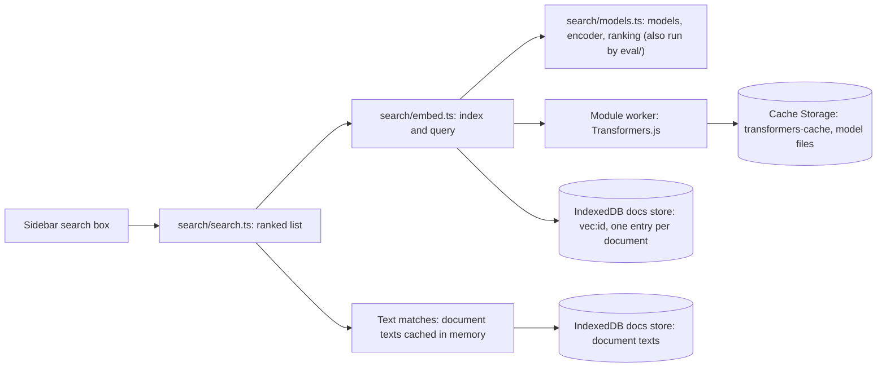
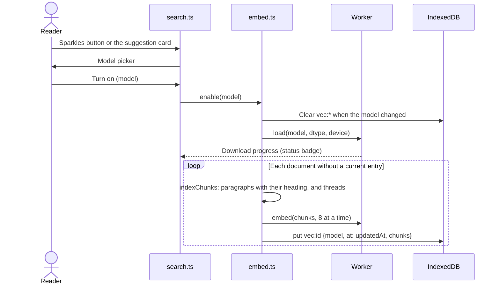
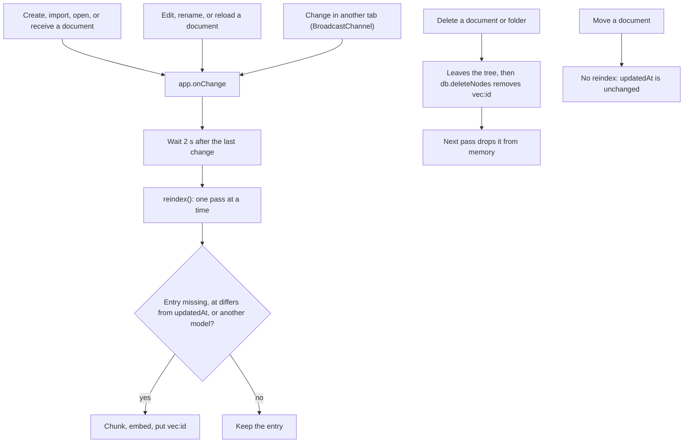
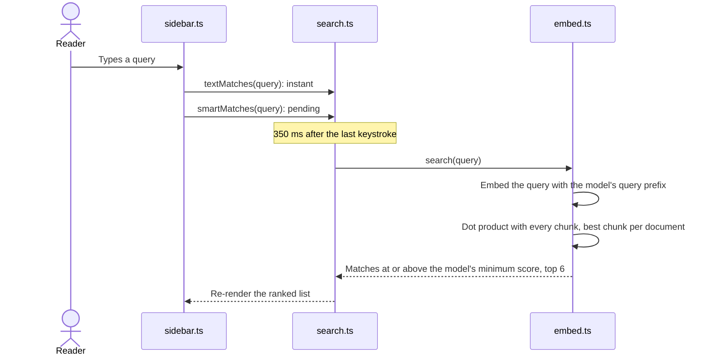

# mars

The MARS (Markdown Annotation & Review System) app, bundled into `dev/tools/mars.html`
through the `data-su-bundle="mars"` placeholder. `npm run build` writes `dist/mars.js`
(esbuild, ESM, minified). See [`dev/tools/guides/mars.md`](../../guides/mars.md).

Pinned runtime dependencies: `marked` 18.1.1 (the version md.html's unpinned CDN load
resolved to when MARS was extracted) and `fflate` 0.8.3 (same as `three-mf`).

```bash
npm ci
npm test            # codec, tree, merge, diff, match, and search logic (node --test)
npm run typecheck
npm run serve       # http://localhost:7373/ (+ /llms.txt), short links on an in-memory KV
npm --prefix eval ci && npm --prefix eval run eval -- --check   # search quality, see Evaluation
```

`src/doc/viewer.js` is a copy of md.html's live script; `src/doc/doc.css` copies its
preview styles. `src/ui/icons.ts` is generated from EUI's SVGs; to add an icon, extend the
`names` map and re-run from the repo root (needs `components/secutils-webui/node_modules`):

```bash
node -e '
const fs = require("fs"), d = "components/secutils-webui/node_modules/@elastic/eui/lib/components/icon/svgs";
const src = "dev/tools/js/mars/src/ui/icons.ts", file = fs.readFileSync(src, "utf8");
const names = { /* camelCaseName: "eui_file_name" */ };
const lines = Object.entries(names).map(([k, f]) => `    ${k}: ${JSON.stringify(fs.readFileSync(`${d}/${f}.svg`, "utf8").replace(/\s+/g, " ").replace(/^.*?<svg[^>]*>/, "").replace(/<\/svg>.*$/, "").trim())},`);
fs.writeFileSync(src, file.replace("} as const;", `${lines.join("\n")}\n} as const;`));
'
```

The logo lives in `dev/tools/mars/assets/` (app icon, favicon, wordmark, and the PNG
favicons rendered from them). `mars.html` inlines copies: the header mark (the wordmark's
planet) and the favicon data URIs. The `--mars-*` / `--brand*` tokens in
`src/ui/tokens.css` follow the logo's reds.

## Search

The sidebar search box matches document names, folder names, document text, and review
comments. With smart search on, it also matches passages and comments by meaning. All
matches appear in one ranked list: name or folder matches first, then text matches with a
snippet, then matches by meaning, marked with sparkles and ordered by similarity. A document
appears once, at its best rank. Opening a text match opens Find on the query; opening a
match in a comment, or by meaning, scrolls to the passage.

Each review thread is indexed as one chunk: its quote and comments, labelled
`Comment on “…”:` (`chunks.threadChunks`). Passages and threads under three words get no
vector (`chunks.embeddable`): a one-word note like "Dog" scores above the cut-off against
almost any short query.

Smart search is off until the reader turns it on and picks a model. Nothing about it ships
in the bundle: Transformers.js loads from jsDelivr, and the model from Hugging Face.



| Model | Hugging Face id | Download | Languages | Vector | License |
|-------|-----------------|----------|-----------|--------|---------|
| Best speed (default) | `Xenova/gte-small` (fp16 on WebGPU, q8 on CPU) | 68 MB / 35 MB | English | 384 | MIT |
| Best quality | `onnx-community/embeddinggemma-2-ONNX` (q4f16, or q4 without `shader-f16`; WebGPU only) | 190 MB / 207 MB | 100+ languages | 768 cut to 256 | Apache-2.0 |

`models.placement` picks the device and weights per browser: float16 weights on a WebGPU
adapter with `shader-f16`, the CPU weights otherwise. The picker shows that download size.

`search/models.ts` holds the model table and the pure parts of embedding: input prefixes,
the encoder, normalization, and ranking. The app's worker and the evaluation both run it, so
the evaluation measures what ships. The encoder follows the model cards: Transformers.js
`AutoModel`, the model's `sentence_embedding` output when it has one (EmbeddingGemma),
otherwise mean pooling (GTE). EmbeddingGemma 2 loads text-only (`vision_config` and
`audio_config` set to null); otherwise its vision and audio encoders download too, 300 MB at q4.

Each model has its own score scale, so each has its own minimum score (`min`), set from the
evaluation's best cut-off. A stored index entry records the model id and quantization, so
changing either for a key rebuilds the index; other changes to what gets embedded need an
`INDEX_VERSION` bump in `search/embed.ts`.

**How the models were picked.** The [evaluation](#evaluation) ran on the public library in
`eval/corpus/`, and the same models ran on a private library of 70 security reviews with
30 questions asked two ways: as sentences and as keywords. Granite Embedding Small R2, the
previous Best speed model, ranks best on the private sentences but worst of the small models
everywhere else, and its scores bunch so tightly that no single cut-off works: readers saw
right answers hidden and unrelated ones shown.

| Model | Public MRR / AUC | Private sentences | Private keywords | Best cut-offs |
|-------|------------------|-------------------|------------------|---------------|
| **GTE Small** (q8) | .949 / 1.000 | .756 / .980 | .755 / .990 | 0.808, 0.815, 0.816 |
| Granite Embedding Small R2 (q8) | .863 / .923 | .852 / .967 | .742 / .970 | 0.80, 0.79, 0.79 |
| all-MiniLM-L6-v2 (q8) | .910 / .977 | .699 / .913 | .759 / .990 | 0.29, 0.30, 0.24 |
| multi-qa-MiniLM-L6-cos-v1 (q8) | .951 / .983 | .650 / .927 | .679 / .990 | 0.31, 0.29, 0.22 |
| **EmbeddingGemma 2** (q4) | .978 / 1.000 | .909 / .990 | .777 / .953 | 0.67, 0.70, 0.67 |

GTE Small separates answers from off-topic queries best of the small models on every set,
and its best cut-off barely moves between them, which a fixed cut-off needs. An earlier round
on the private sentences also ruled out EmbeddingGemma 300M, Jina Embeddings v5 Text Nano,
and Harrier OSS v1 (270M and 0.6B): each ranked below EmbeddingGemma 2, and Harrier 0.6B
indexed 2.4 times slower.

**Quantization.** Smaller weights load faster and download less; the question is what they
cost in quality. On the public library:

| Model | dtype | Download | MRR | Found | Clean | Node CPU ms per chunk |
|-------|-------|----------|-----|-------|-------|-----------------------|
| GTE Small | fp32 | 134 MB | .951 | 98% | 100% | 13 |
| GTE Small | **fp16** (WebGPU) | **67 MB** | .951 | 98% | 100% | 19 |
| GTE Small | **q8** (CPU) | **35 MB** | .949 | 96% | 100% | 8 |
| GTE Small | q4f16 | 37 MB | .911 | 100% | 92% | 17 |
| EmbeddingGemma 2 | q8 | 346 MB | .978 | 93% | 100% | 101 |
| EmbeddingGemma 2 | **q4** (no `shader-f16`) | **207 MB** | .978 | 91% | 100% | 81 |
| EmbeddingGemma 2 | **q4f16** (WebGPU) | **190 MB** | .978 | 91% | 100% | 107 |

q8 keeps GTE's full-precision quality at a quarter of the size; its q4 and bnb4 files are
larger than q8 (about 60 MB), so they were not tried. EmbeddingGemma 2 scores the same in all
three. Its model card puts q8 at 0.9997 cosine similarity to fp32, so q8 stands in for fp32
here. The CPU timings above are Node's; on WebGPU the float16 files (GTE fp16, EmbeddingGemma
q4f16) are the fast ones (see Devices), so those ship for GPUs with `shader-f16`.

### Turning it on



**Devices.** The Best quality model runs on WebGPU only, and the model picker disables it
without a hardware adapter (`hasGpu` rejects software fallback adapters). On WebAssembly it
lacks an operator its q4 weights use, and would take minutes per document. Best speed runs on
WebGPU at fp16 when the adapter has `shader-f16`, and on WebAssembly at q8 otherwise; a
WebGPU failure falls back to WebAssembly with the q8 weights. On WebGPU, 8-bit weights are
the slow choice: ONNX Runtime runs float16 far faster. Per chunk on an Apple M-series laptop:

| Model and device | Chrome | Firefox |
|------------------|--------|---------|
| GTE Small fp16, WebGPU | 7 ms | not measured (headless Firefox blocks WebGPU) |
| GTE Small fp32, WebGPU | 10 ms | |
| GTE Small q8, WebGPU | 78 ms | |
| GTE Small q8, WebAssembly, 4 threads | 48 ms | 600 ms |
| GTE Small q8, WebAssembly, 1 thread | 179 ms | 2,276 ms |
| EmbeddingGemma 2 q4f16, WebGPU | 23 ms | |
| EmbeddingGemma 2 q4, WebGPU | 39 ms | |

Firefox's WebAssembly was as slow with fp32 and fp16 weights and with ONNX Runtime's plain
(non-asyncify) build: a 13-document library (244 chunks) took it about 3 minutes on threads.
In Chrome the same library indexes in 3.3 s with Best speed on WebGPU, 20 s on threads, and
9.9 s with Best quality.

Replacing a model, or its weights, rebuilds readers' indexes. The replaced files stay in
their Cache Storage until they turn smart search off, which deletes every model.

**Threads** (the fallback without a GPU) need cross-origin isolation: the MARS responder sends
`Cross-Origin-Opener-Policy: same-origin` and `Cross-Origin-Embedder-Policy: credentialless`
(`dev/tools/deploy.ts`; `serve.mjs` locally). `credentialless` keeps cross-origin map tiles,
fonts, and scripts loading without CORP headers. Safari ignores it and stays single-threaded.

**Status badge**: a badge beside the Documents title, so the tree never shifts. It reads
"Downloading N%" (first use only), "Preparing", "Indexing N/M", "Paused" (warning colors), or
"Unavailable" (danger colors), with the full sentence in its tooltip, and hides when idle.
Clicking it opens the smart-search menu. `embed.ts` emits a `Status` (state, short label, full
text); a visually hidden live region announces state changes, not each document.

**Browser test.** `e2e/tools/mars-smart.spec.ts` runs the built page with each model: it
indexes a fixture, asserts a match by meaning and a miss for an unrelated word, and checks the
picker's Downloaded badge. Another case pauses indexing, imports a document, and checks it
matches only after **Resume indexing**. It runs in a persistent browser profile (`e2e/.cache/profile/`,
gitignored), so each model downloads once; after that the spec takes about 15 seconds. Point
`MARS_SMART_LIBRARY` at an export `.zip` to time a real library, with `MARS_SMART_QUERIES`
(`|`-separated) to log its matches, and set `MARS_SMART_DEVICE=cpu` to hide the GPU. Test
WebGPU without `--enable-unsafe-webgpu`: that flag exposes experimental features (subgroup
matrices) that ONNX Runtime then picks and fails on.

### Evaluation

`eval/` measures search quality in Node, on CPU, with the app's own chunking, encoder, and
ranking. It is a separate package because Transformers.js for Node brings ONNX Runtime
(about 300 MB) that the app bundle never needs; its version must match
`TRANSFORMERS_VERSION`.

- `eval/corpus/`: a public, fictional library (24 documents in nested folders: notes, designs,
  runbooks, recipes; Mermaid diagrams, math, code; single comments and threads with replies).
  Some answers exist only in a comment.
- `eval/queries.json`: 56 queries (31 of up to three words, 25 sentences), each with the
  documents that answer it (`expect`) and documents that are fair to show (`also`), plus 12
  off-topic queries that should show nothing.
- `eval/bars.json`: the quality bar per shipped model and dtype (`fast@q8`, `fast@fp16`): each metric's
  floor, a little below its measured value.
- `eval/.cache/` (gitignored): downloaded models.

Metrics, per model:

| Metric | Meaning |
|--------|---------|
| MRR, nDCG@10, Hit@1, Hit@3 | Ranking quality over every document, ignoring the cut-off. `also` documents are left out. |
| Found | Share of queries whose answer the sidebar shows: at or above `min`, in the top 6. |
| Precision | Share of shown results that are an answer or an `also` document. |
| Clean | Share of off-topic queries that show nothing. |
| AUC | How well the answer's score separates from the top off-topic score (1 is perfect). |
| Best cut | The `min` with the best balanced accuracy between answers and off-topic queries. |
| MB, ms/chunk, ms/query | Download size and Node CPU speed. On WebGPU the fast dtypes differ (see Devices). |

CI (`.github/workflows/mars.yml`) runs `npm test`, the typecheck, and the Best speed check (q8 and fp16)
on every change under `dev/tools/js/mars/`. Best quality is checked locally: its 190 to 207 MB download
and CPU time are too heavy for every push.

Run it after any change to `search/models.ts` or `search/chunks.ts`, a Transformers.js
upgrade, or a new model or dtype:

1. `npm ci` in `eval/`, then `npm run eval -- --check --verbose` there. It evaluates each shipped
   model with its CPU and WebGPU weights; pass model keys to pick others (`fast`, `best`, a `CANDIDATES` key in
   `eval/eval.ts`, optionally with `@<dtype>`, such as `best@q4f16`).
2. Read the misses that `--verbose` marks with ✗. A regression from a chunking change shows up
   there before it shows up in the averages.
3. For a new model or dtype: add it to `CANDIDATES` in `eval/eval.ts` (same fields as
   `MODELS`), compare it with the shipped one, and check its reference code on the Hugging
   Face model card (pooling, prefixes, outputs). To ship it, update `MODELS` with `min` set
   near its best cut (and `gpuDtype` when its float16 weights run faster on WebGPU: time them
   in a browser), and replace the old model's `bars.json` rows with a row per new dtype.
4. When the corpus or queries change, re-measure and set the `bars.json` floors a little
   below the new values. Keep `eval/corpus/` fictional: no real names, data, or employers.

Completion: `npm run eval -- --check` prints "All models meet bars.json", and any changed
floor or `min` is explained in the change description.

### Keeping the index current

An entry is current when its `at` equals the document's `updatedAt` and its model is the
selected model. Every tree change schedules one pass over the stale documents, 2 seconds
after the last change. Passes never overlap: a change during a pass queues one more pass after it.
A pass skips documents deleted since it started and writes no entry for them.



- **Edits**: autosave updates `updatedAt`, so a document re-embeds once you stop typing for
  2 seconds. ponytail: the whole document re-embeds; per-chunk reuse would matter only for
  very long documents.
- **Renames** re-embed, because EmbeddingGemma prefixes each chunk with the document name.
- **Other tabs**: each tab runs its own worker and indexes on its own. Two open tabs may embed
  the same change twice; the result is the same entry.
- **Pause**: **Pause indexing** in the sparkles menu stops a pass after the current document, and
  the status badge says "Paused". Search keeps using the entries already stored.
  **Resume indexing** runs one pass, which catches up on every document added or edited
  meanwhile and skips deleted ones. The pause is held in memory only, so a reload resumes. An
  import of 20 or more documents offers **Pause indexing** on its toast, so you can remove the
  files you don't need before they are embedded.
- **Imports**: a folder deleted while an import runs stays deleted. The import leaves out its
  remaining files and removes anything it created under the deleted folder.
- **Size**: a 384-value vector is 1.5 KB per chunk, and a chunk is a paragraph or a few short
  ones (up to 500 characters; longer single paragraphs and code blocks are cut at 1,500).

### Searching



The sidebar keeps the last query's matches only while the index is unchanged: a pass that
changes the index bumps `indexRevision()`, and the open query runs again, keeping its
previous matches on screen until the new ones arrive.

### Models and space

The sparkles button opens a menu: change the model (rebuilds the index), pause or resume
indexing, rebuild the index, remove downloaded models other than the current one, or turn smart search off. Turning off
removes the index and every downloaded model. Model files sit in the browser's Cache Storage
(`transformers-cache`), keyed by their Hugging Face URL; `embed.removeModel` deletes one
model's files.

### The suggestion

With smart search off, a card at the bottom of the sidebar suggests it at 6, 20, and 50
documents, then every 10 more (`chunks.nudgeDue`). Each threshold shows once.
**Don't ask again** stops it for good. State: `localStorage["mars.smartNudge"]`.
