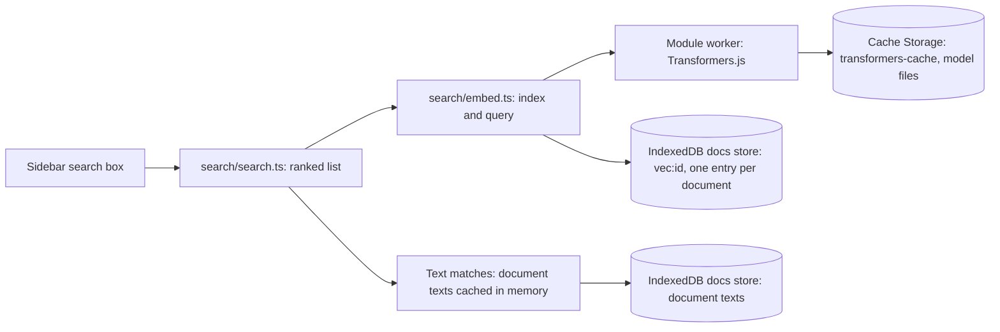
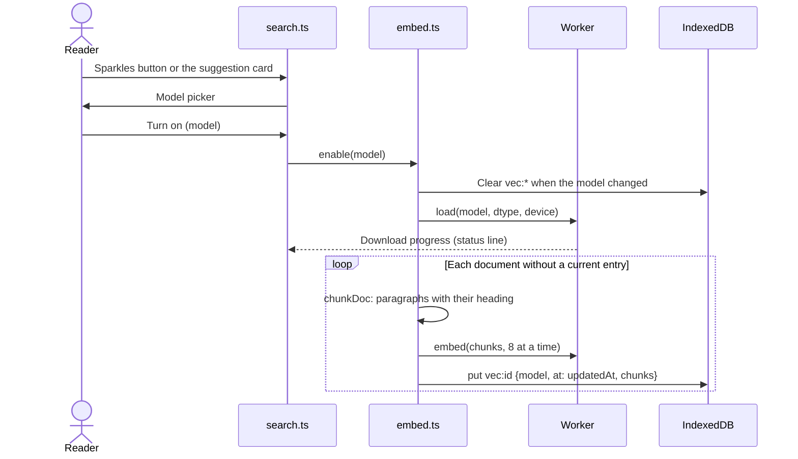
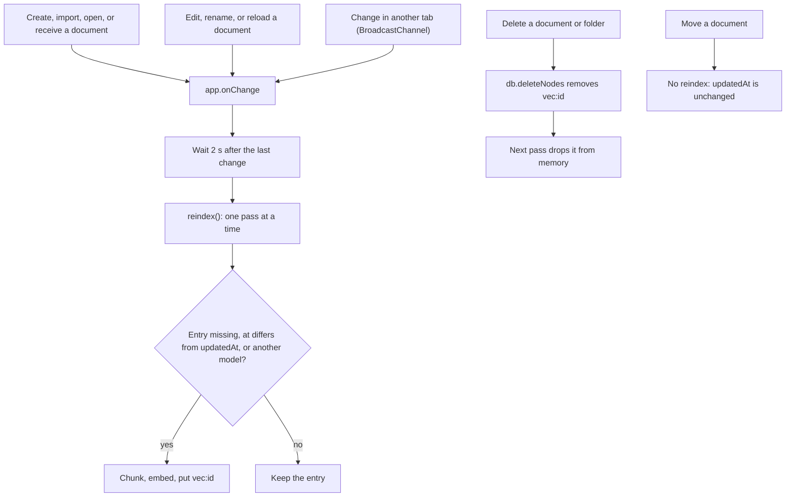
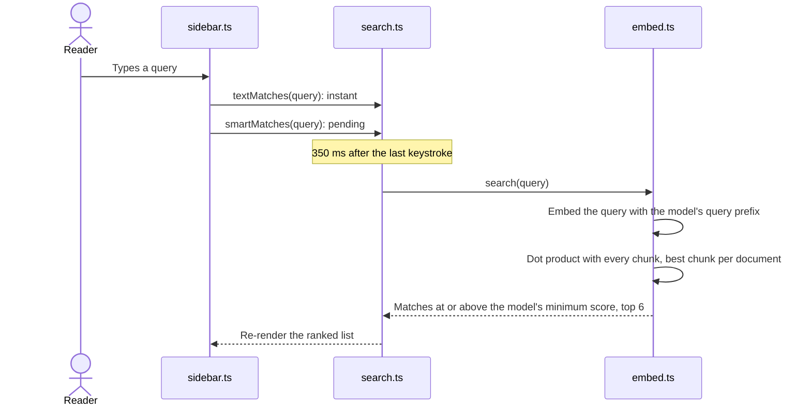

# mars

The MARS (Markdown Annotation & Review System) app, bundled into `dev/tools/mars.html`
through the `data-su-bundle="mars"` placeholder. `npm run build` writes `dist/mars.js`
(esbuild, ESM, minified). See [`dev/tools/guides/mars.md`](../../guides/mars.md).

Pinned runtime dependencies: `marked` 18.1.1 (the version md.html's unpinned CDN load
resolved to when MARS was extracted) and `fflate` 0.8.3 (same as `three-mf`).

```bash
npm ci
npm test            # codec, tree, merge, diff, match, and search logic (node --test)
npm run typecheck
npm run serve       # http://localhost:7373/ (+ /llms.txt), short links on an in-memory KV
```

`src/doc/viewer.js` is a copy of md.html's live script; `src/doc/doc.css` copies its
preview styles. `src/ui/icons.ts` is generated from EUI's SVGs; to add an icon, extend the
`names` map and re-run from the repo root (needs `components/secutils-webui/node_modules`):

```bash
node -e '
const fs = require("fs"), d = "components/secutils-webui/node_modules/@elastic/eui/lib/components/icon/svgs";
const src = "dev/tools/js/mars/src/ui/icons.ts", file = fs.readFileSync(src, "utf8");
const names = { /* camelCaseName: "eui_file_name" */ };
const lines = Object.entries(names).map(([k, f]) => `    ${k}: ${JSON.stringify(fs.readFileSync(`${d}/${f}.svg`, "utf8").replace(/\s+/g, " ").replace(/^.*?<svg[^>]*>/, "").replace(/<\/svg>.*$/, "").trim())},`);
fs.writeFileSync(src, file.replace("} as const;", `${lines.join("\n")}\n} as const;`));
'
```

The logo lives in `dev/tools/mars/assets/` (app icon, favicon, wordmark, and the PNG
favicons rendered from them). `mars.html` inlines copies: the header mark (the wordmark's
planet) and the favicon data URIs. The `--mars-*` / `--brand*` tokens in
`src/ui/tokens.css` follow the logo's reds.

## Search

The sidebar search box matches document names, folder names, document text, and review
comments. With smart search on, it also matches passages and comments by meaning. All
matches appear in one ranked list: name or folder matches first, then text matches with a
snippet, then matches by meaning, marked with sparkles and ordered by similarity. A document
appears once, at its best rank. Opening a text match opens Find on the query; opening a
match in a comment, or by meaning, scrolls to the passage.

Each review thread is indexed as one chunk: its quote and comments, labelled
`Comment on “…”:` (`chunks.threadChunks`). Passages and threads under three words get no
vector (`chunks.embeddable`): a one-word note like "Dog" scores above the cut-off against
any short query ("document": 0.33 with Best speed, 0.46 with Best quality).

Smart search is off until the reader turns it on and picks a model. Nothing about it ships
in the bundle: Transformers.js loads from jsDelivr, and the model from Hugging Face.



| Model | Hugging Face id | Download | Languages | Vector | License |
|-------|-----------------|----------|-----------|--------|---------|
| Best speed (default) | `onnx-community/granite-embedding-small-english-r2-ONNX` (q8) | 55 MB | English | 384 | Apache-2.0 |
| Best quality | `onnx-community/embeddinggemma-2-ONNX` (q4, WebGPU only) | 174 MB | 100+ languages | 768 cut to 256 | Apache-2.0 |

Each model has its own score scale, so each has its own minimum score (`min` in
`search/embed.ts`), measured on a real library: unrelated queries stay below it and real
matches above. Each model also has its own pooling: Granite uses its CLS token, and
EmbeddingGemma's embedding is its `sentence_embedding` output. Mean pooling EmbeddingGemma's
token states (the feature-extraction pipeline's default) skips its projection layers and
matches noise. Changing how a model embeds needs an `INDEX_VERSION` bump, so stored indexes
rebuild.

**How the models were picked.** Seven candidates ran on 70 real security-review reports
(936 chunks) with 30 paraphrased queries that each have one known answer, plus 10 off-topic
queries that should match nothing. MRR is mean reciprocal rank. R@1 and R@3 are the share
of queries with the answer first or in the top three. AUC measures how well scores separate
real matches from off-topic queries, and "Cut" is the best minimum score with the share of
queries it classifies right. Index time is Node, CPU only.

| Model | MRR | R@1 | R@3 | AUC | Cut | Index |
|-------|-----|-----|-----|-----|-----|-------|
| all-MiniLM-L6-v2 (old Best speed) | .699 | 60% | 77% | .913 | 0.30 (93%) | 14 s |
| **Granite Embedding Small English R2** | .852 | 80% | 87% | .967 | 0.79 (95%) | 27 s |
| EmbeddingGemma 300M (old Best quality) | .850 | 77% | 93% | 1.000 | 0.46 (100%) | 104 s |
| **EmbeddingGemma 2 270M** | .909 | 87% | 93% | .990 | 0.70 (98%) | 258 s |
| Jina Embeddings v5 Text Nano (retrieval) | .802 | 73% | 83% | .997 | 0.29 (98%) | 146 s |
| Harrier OSS v1 270M | .794 | 67% | 90% | .997 | 0.49 (98%) | 161 s |
| Harrier OSS v1 0.6B | .866 | 80% | 93% | 1.000 | 0.51 (100%) | 623 s |

Granite ranks almost as well as the old Best quality model at a quarter of its index time.
EmbeddingGemma 2 ranks best, and on WebGPU it indexes as fast as its predecessor. Harrier
0.6B separates off-topic queries perfectly, but it is a 0.6B download and indexes 2.4 times
slower. Jina pools the last token, which Transformers.js gets wrong for padded batches.

### Turning it on



**Devices.** The Best quality model runs on WebGPU only, and the model picker disables it
without a hardware adapter (`hasGpu` rejects software fallback adapters). On WebAssembly it
lacks an operator its q4 weights use, and would take minutes per document. Best speed runs
on WebAssembly threads when the page is cross-origin isolated, and on WebGPU otherwise
(Safari), when there is one. Indexing the 936 benchmark chunks in Chrome on an Apple M-series
laptop:

| Model | WebAssembly, threads | WebGPU | WebAssembly, one thread |
|-------|----------------------|--------|-------------------------|
| Best speed | 124 s | - | 480 s |
| Best quality | - | 77 s | - |

Earlier models are retired (`RETIRED` in `search/embed.ts`): all-MiniLM-L6-v2,
EmbeddingGemma 300M, and multilingual-e5-small. Their cached files are deleted on load, and a
browser that used e5 switches to Best speed. The index rebuilds with the current model.

**Threads** need cross-origin isolation: the MARS responder sends
`Cross-Origin-Opener-Policy: same-origin` and `Cross-Origin-Embedder-Policy: credentialless`
(`dev/tools/deploy.ts`; `serve.mjs` locally). `credentialless` keeps cross-origin map tiles,
fonts, and scripts loading without CORP headers. Safari ignores it and stays single-threaded.

**Status line**: "Preparing the … model", "Downloading the … model… N%" (first use only), then
"Indexing N of M". A failure shows there too.

**Testing.** `e2e/tools/mars-smart.spec.ts` indexes a fixture with each model and asserts a
match by meaning and a miss for an unrelated word. It runs in a persistent browser profile
(`e2e/.cache/profile/`, gitignored), so each model downloads once; after that the spec takes
about 15 seconds. Point `MARS_SMART_LIBRARY` at an export `.zip` to time a real library, and
set `MARS_SMART_DEVICE=cpu` to hide the GPU. Test WebGPU without `--enable-unsafe-webgpu`: that
flag exposes experimental features (subgroup matrices) that ONNX Runtime then picks and fails on.

### Keeping the index current

An entry is current when its `at` equals the document's `updatedAt` and its model is the
selected model. Every tree change schedules one pass over the stale documents, 2 seconds
after the last change. Passes never overlap.



- **Edits**: autosave updates `updatedAt`, so a document re-embeds once you stop typing for
  2 seconds. ponytail: the whole document re-embeds; per-chunk reuse would matter only for
  very long documents.
- **Renames** re-embed, because EmbeddingGemma prefixes each chunk with the document name.
- **Other tabs**: each tab runs its own worker and indexes on its own. Two open tabs may embed
  the same change twice; the result is the same entry.
- **Size**: a 384-value vector is 1.5 KB per chunk, and a chunk is a paragraph or a few short
  ones (up to 1,200 characters).

### Searching



### Models and space

The sparkles button opens a menu: change the model (rebuilds the index), rebuild the index,
remove downloaded models other than the current one, or turn smart search off. Turning off
removes the index and every downloaded model. Model files sit in the browser's Cache Storage
(`transformers-cache`), keyed by their Hugging Face URL; `embed.removeModel` deletes one
model's files.

### The suggestion

With smart search off, a card at the bottom of the sidebar suggests it at 6, 20, and 50
documents, then every 10 more (`chunks.nudgeDue`). Each threshold shows once.
**Don't ask again** stops it for good. State: `localStorage["mars.smartNudge"]`.
