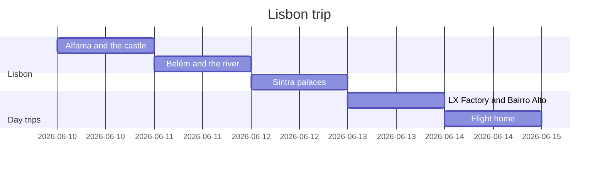

# Lisbon trip, June

Five days in Lisbon with a day trip to Sintra.

## Getting around

Buy a rechargeable transit card at the airport metro station. Tram 28 is crowded after 10:00,
so ride it early. The train to Sintra leaves from Rossio every 20 minutes.

## Where we stay

A small apartment in Graça with a view over the rooftops. Check-in is after 15:00, and the
keys are in a lockbox by the door.

## Food to try

Custard tarts in Belém, grilled sardines, and a bifana from a corner café.

<!-- su-comments
[
  {
    "id": "5a8d0e27",
    "quote": "A small apartment in Graça",
    "comments": [
      { "id": "b3c9f410", "author": "Riley", "at": "2026-05-02T11:00:00.000Z", "body": "Who looks after the cat while we are away? Ask the neighbor to come by twice a day and refill the water bowl." },
      { "id": "e62a1d8f", "author": "Sam", "at": "2026-05-02T12:15:00.000Z", "body": "The neighbor said yes; I left a spare key with her." }
    ]
  }
]
-->
