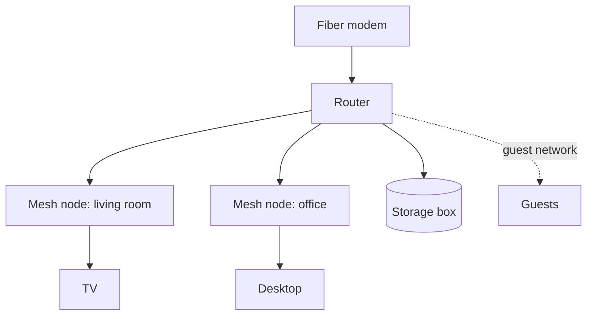

# Home network

Notes from Jamie on how the flat is wired, for whoever fixes it next.

## Wi-Fi

Two networks: the main one for our devices and a guest one that cannot see the storage box or
the printer. The mesh nodes use a wired backhaul, which doubled the speed in the office.

## Addresses

The router hands out addresses from `192.168.20.100` to `.200`. The storage box and the
printer have fixed addresses below `.100`.

Our cat Miso likes to sleep on top of the warm router.

Each mesh node shows a white light when its backhaul is wired and blue when it falls back
to Wi-Fi. Firmware updates install at 03:00 and restart the nodes one at a time, so the
network never goes fully down. The router keeps a log of the last 500 connection events,
which helps when a device drops off the network at the same time every day.

## Remote access

A WireGuard tunnel on the router lets us reach the storage box from outside. Port 51820 is
the only port forwarded.

## When the internet is down

1. Check the modem lights: a red light means the line, so call the provider.
2. Restart the router, then the mesh nodes, in that order.
3. If only Wi-Fi is down, plug a laptop into the router to tell the two apart.
