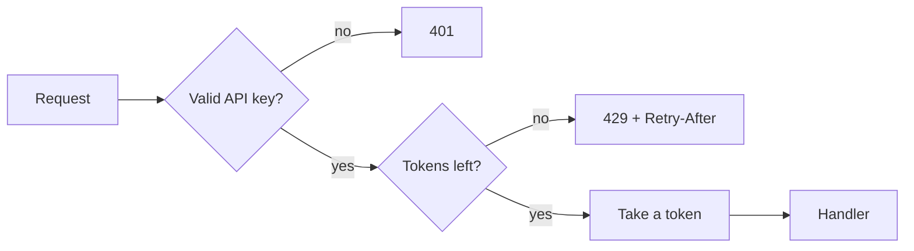

# API rate limiting

A single customer script sent 40,000 requests a minute last month and slowed the API for
everyone. This design adds per-key limits.

## Algorithm

Each API key gets a token bucket: capacity 120, refilled at 20 tokens a second. A request
takes one token; an empty bucket answers `429 Too Many Requests` with a `Retry-After` header.

## Storage

Buckets live in Redis as two fields per key, updated by one Lua script so the read and the
write are atomic. A Redis outage fails open: requests pass, and an alert fires.

## Limits per plan

| Plan | Capacity | Refill per second |
|------|----------|-------------------|
| Free | 30 | 2 |
| Team | 120 | 20 |
| Business | 600 | 100 |

## Headers

Every response carries `RateLimit-Limit`, `RateLimit-Remaining`, and `RateLimit-Reset`, so
clients can slow down before they hit the limit.

<!-- su-comments
[
  {
    "id": "4e0c8b9d",
    "quote": "A Redis outage fails open",
    "comments": [
      { "id": "9f3e1a07", "author": "Lee", "at": "2026-03-01T13:30:00.000Z", "body": "Failing open means an attacker who can take Redis down also removes the limits. Should we fall back to a small in-memory limit per process?" },
      { "id": "2b8d5c46", "author": "Kim", "at": "2026-03-01T14:02:00.000Z", "body": "Yes: an in-memory bucket per process, a tenth of the plan's capacity, until Redis is back." },
      { "id": "6a0f9e13", "author": "Lee", "at": "2026-03-02T09:45:00.000Z", "body": "Updated the design; resolving." }
    ],
    "resolved": true
  }
]
-->
