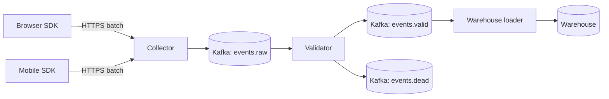

# Event pipeline design

Product analytics events (page views, clicks, purchases) reach the warehouse through a
nightly batch today, so dashboards are a day behind. This design streams them instead,
with data in the warehouse within two minutes.

## Goals

- Under two minutes from the browser to the warehouse at the 99th percentile.
- No lost events when a downstream system is down for up to six hours.
- Each event lands exactly once in the warehouse tables.
- Cost no higher than the batch system plus 20%.

## Non-goals

- Real-time personalization. That team reads from the same stream later, but its needs do
  not shape this design.
- Replacing the marketing tags on the website.

## Architecture

## Collector

A stateless HTTP service behind the load balancer. It accepts batches of up to 500 events,
adds the receive time and the client IP country, and writes the batch to `events.raw`. It
answers `202 Accepted` once Kafka confirms the write, so clients retry only on real failures.
The SDKs keep unsent events in local storage and retry with exponential backoff.

## Validation

Every event type has a JSON schema in the schema registry. The validator checks each event
against its schema version. Valid events go to `events.valid`; invalid ones go to the dead
letter topic with the error, and a dashboard counts them per type and client version. A
spike usually means an app release sent a renamed field.

## Exactly once

Each event carries a client-generated UUID. The loader writes in micro-batches of up to 30
seconds and merges on the event ID, so a retried batch overwrites instead of duplicating.
Kafka offsets are committed only after the warehouse confirms the merge.

## Retention and replay

`events.raw` keeps seven days. When a loader bug corrupts data, we fix the loader, reset its
consumer group to the time before the bug, and replay. The merge on event ID makes a replay
safe to run twice.

## Capacity

Peak traffic is 18,000 events a second during sales. Twelve partitions per topic leave room
for three times that. The collector scales on CPU; four instances handle the peak with half
their capacity unused.

## Monitoring

- Consumer lag per topic, alerting above five minutes.
- Dead-letter rate per event type, alerting above 1% of the type's volume.
- End-to-end latency, measured by a synthetic event sent every minute.

## Rollout

1. Run the stream next to the batch job for two weeks and compare daily counts per type.
2. Switch the dashboards to the streamed tables one team at a time.
3. Turn the batch job off after a month without differences above 0.1%.

## Alternatives considered

- **A managed streaming service from the cloud provider**: less to operate, but its
  per-event price is three times our budget at peak.
- **Writing straight from the collector to the warehouse**: simpler, but a warehouse outage
  would lose events or push retries back to the clients.

<!-- su-comments
[
  {
    "id": "6f1d8a3c",
    "quote": "merges on the event ID",
    "comments": [
      { "id": "c2e7b049", "author": "Kim", "at": "2026-05-06T11:30:00.000Z", "body": "Merging over the full table gets slow. Restrict the merge to the last two days of partitions; late events older than that go to a daily repair job." },
      { "id": "93b5a1d6", "author": "Ravi", "at": "2026-05-06T13:10:00.000Z", "body": "Agreed. Added to the loader section in the next revision." }
    ]
  },
  {
    "id": "a8e4c27b",
    "quote": "Twelve partitions per topic",
    "comments": [
      { "id": "54f0d9e8", "author": "Ravi", "at": "2026-05-07T09:00:00.000Z", "body": "Partition by user ID so one user's events stay in order." }
    ]
  }
]
-->
