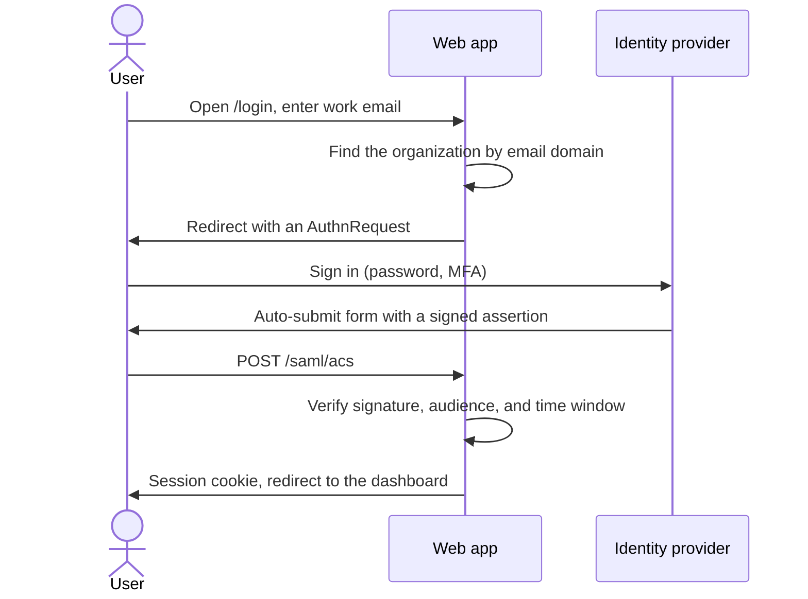

# Single sign-on with SAML

Customers on the Business plan want their staff to log in with the company identity
provider (Okta, Entra ID, or Google Workspace) instead of a separate password. This design
adds SAML 2.0 service-provider support to the web app.

## Flow

## Configuration per organization

| Field | Example | Notes |
|-------|---------|-------|
| Entity ID | `https://idp.example.com/metadata` | From the IdP metadata |
| SSO URL | `https://idp.example.com/sso` | Where the AuthnRequest goes |
| Signing certificate | PEM | Rotated by the customer; we keep two |
| Email domains | `example.com` | Routes users to this IdP |

## Account linking

The first SAML login for an email that already has a password account links the two after
the user confirms with the old password. New emails get an account on the fly
(just-in-time provisioning) with the organization's default role.

## Security checks

- Reject assertions older than five minutes or not yet valid, allowing 60 seconds of clock skew.
- Require the assertion, not only the response, to be signed.
- Store the assertion ID for ten minutes to block replays.
- Ignore the `RelayState` URL unless it points to our own host.

## Open questions

- Do we support IdP-initiated login, or only the flow that starts at our login page?
- SCIM for deprovisioning is a separate project.

<!-- su-comments
[
  {
    "id": "8c1e4b70",
    "quote": "Do we support IdP-initiated login",
    "comments": [
      { "id": "f2a6d913", "author": "Priya", "at": "2026-02-11T14:03:00.000Z", "body": "Several customers launch apps from the Okta dashboard, so they expect it. It is riskier: no request ID to match." },
      { "id": "1d7b0c48", "author": "Tomás", "at": "2026-02-11T15:20:00.000Z", "body": "Then ship it behind a per-organization toggle, off by default." }
    ]
  },
  {
    "id": "26e9a5bf",
    "quote": "we keep two",
    "comments": [
      { "id": "7ab43c0e", "author": "Priya", "at": "2026-02-12T09:00:00.000Z", "body": "Two lets the customer rotate the certificate without a login outage." }
    ]
  }
]
-->
