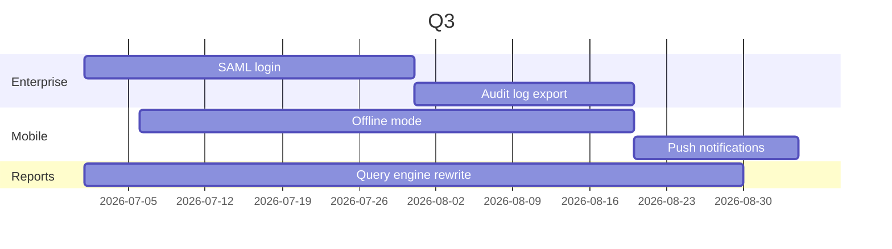

# Q3 roadmap

Three themes this quarter: enterprise readiness, mobile, and faster reports.

## Enterprise readiness

Single sign-on and an exportable audit log are the two most common blockers in large deals.

## Mobile

Field teams lose signal in warehouses. Offline mode keeps the last 30 days of orders on the
phone and syncs changes when the connection returns.

## Faster reports

Monthly reports take up to two minutes for large accounts. The goal is under ten seconds at
the 95th percentile.

## Not this quarter

Dark mode, a public API v2, and the marketplace.
