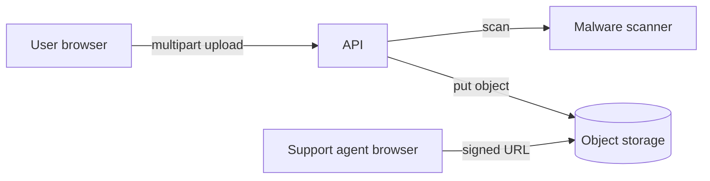

# Threat model: file uploads

Users attach files (images, PDFs, spreadsheets) to support tickets. Files go to object
storage and are shown to support agents in the browser.

## Data flow

## Threats

| Threat | Example | Mitigation |
|--------|---------|------------|
| Spoofing | Upload with another user's ticket ID | Check that the ticket belongs to the session user |
| Tampering | Replace a file after the scan | Object keys are random; no overwrite permission |
| Information disclosure | Guessable file URLs | Signed URLs that expire after five minutes |
| Denial of service | 5 GB upload | 25 MB limit at the load balancer and in the API |
| Elevation of privilege | `../../etc/passwd` as the file name | Never use the client file name in the storage path |
| Stored XSS | An SVG or HTML file with a script | Serve with `Content-Disposition: attachment` from a separate domain |

## Malware

Every file is scanned before it becomes visible. Files that fail the scan are kept in a
quarantine bucket for 30 days for investigation, then deleted.

## Residual risks

Macros in spreadsheets are not removed. Support agents open spreadsheets in a sandboxed
viewer only.
